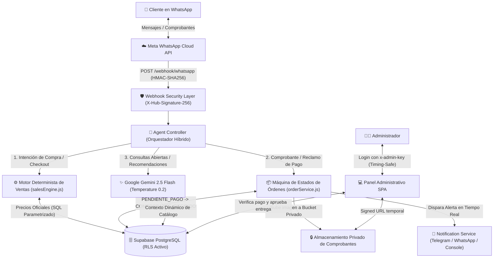

# 🚀 WhatsApp AI Sales Agent & Order Management System


-critical)

Sistema Full-Stack de **Automatización Comercial y Gestión de Pedidos 24/7 por WhatsApp**, impulsado por **Google Gemini AI**, **Meta WhatsApp Cloud API**, **Node.js/Express** y **Supabase (PostgreSQL)**.

Diseñado con una arquitectura **híbrida determinista + IA generativa** donde los precios, el catálogo y la máquina de estados de órdenes están estrictamente controlados por la base de datos relacional, evitando alucinaciones de precios o confirmaciones de pago no autorizadas por parte del modelo de lenguaje.

---

## 🏗️ Arquitectura del Sistema



---

## 🔒 Ingeniería de Seguridad (DevSecOps Highlights)

Este proyecto implementa controles de seguridad de nivel producción auditables mediante `npm run test:security`:

1. **Precios Controlados por Base de Datos y Anti-Fraude en Pagos (`agentController.js` + `salesEngine.js`):**
   - El checkout (`createPendingOrder`) toma el `total_amount` exclusivamente desde PostgreSQL (`products` / `combos`), nunca del texto generado por Gemini.
   - Cualquier mensaje o imagen de pago es interceptado **antes** de llegar al LLM y transiciona la orden únicamente a `COMPROBANTE_RECIBIDO`. El estado `VERIFICADO` / `ENTREGADO` solo puede ser accionado por un administrador autenticado en el panel.
2. **Validación Criptográfica de Webhooks (`X-Hub-Signature-256`):**
   - Middleware dedicado (`verifyWebhookSignature`) que captura el `req.rawBody` en buffer, calcula el `HMAC-SHA256` usando `WHATSAPP_APP_SECRET` y verifica la firma de Meta con `crypto.timingSafeEqual` para prevenir falsificación de eventos y ataques de temporización.
3. **Autenticación Fail-Closed en Panel y API (`adminAuth`):**
   - Todas las rutas administrativas (`/api/*`) requieren la cabecera `x-admin-key` validada en tiempo constante (`crypto.timingSafeEqual`). Si `ADMIN_KEY` no está configurada en el servidor, el sistema falla cerrado (`HTTP 503`).
4. **Row Level Security (RLS) en PostgreSQL (`database/schema.sql`):**
   - Las 7 tablas del esquema tienen `ENABLE ROW LEVEL SECURITY` activo por defecto, bloqueando cualquier acceso directo desde la llave pública `anon` de Supabase y permitiendo operaciones únicamente al backend autenticado.
5. **Privacidad de Comprobantes de Pago (`storageService.js`):**
   - Los comprobantes enviados por los clientes se almacenan en un bucket privado de Supabase (o directorio privado local no expuesto por `express.static`) y se sirven al panel administrativo únicamente mediante **Signed URLs temporales (1 hora)** o streams autenticados (`GET /api/orders/:id/receipt-image`).
6. **Prevención de Inyección SQL y Prompt Injection:**
   - 100% de las consultas SQL usan parámetros posicionales (`$1, $2`) con el driver `pg`.
   - Sanitización de entrada de usuario, límite de longitud, `temperature: 0.2` en Gemini y Rate Limiting por IP/Teléfono.

---

## ✨ Características Principales

- **Catálogo Dinámico de Suscripciones Cloud & SaaS (NovaCloud Digital):** Consulta de licencias individuales, paquetes Full-Stack y recomendaciones personalizadas según el presupuesto del cliente.
- **Máquina de Estados de Pedidos:** Ciclo de vida trazable (`PENDIENTE_PAGO` → `COMPROBANTE_RECIBIDO` → `VERIFICADO` → `ENTREGADO` / `CANCELADO`).
- **Hand-off Inteligente a Humano:** Si el usuario solicita hablar con un asesor o el administrador pausa el bot desde el panel, el agente silencia sus respuestas automáticas para ese cliente (`bot_paused = true`) y emite una alerta inmediata.
- **Motor de Respaldo Determinista (Zero-Downtime Fallback):** Si la API de Gemini no está disponible o alcanza límite de cuota, el sistema conmuta automáticamente a un motor determinista basado en expresiones regulares y búsqueda directa en PostgreSQL sin interrumpir las ventas.
- **Panel Administrativo SPA (Dark UI):** Gestión en tiempo real de pedidos, visor privado de comprobantes de pago, edición de precios del catálogo, configuración de métodos de pago y botón de emergencia para pausar/reactivar el bot.

---

## 🛠️ Stack Tecnológico

| Capa | Tecnología |
| :--- | :--- |
| **Backend & API** | Node.js, Express.js |
| **Inteligencia Artificial** | Google Gemini API (`gemini-2.5-flash`) |
| **Mensajería Oficial** | Meta WhatsApp Cloud API (Graph API v20.0) |
| **Base de Datos** | PostgreSQL en Supabase (Pool de conexiones IPv4 + RLS) |
| **Almacenamiento** | Supabase Storage (Bucket Privado + Signed URLs) |
| **Frontend Admin** | Vanilla JS SPA, CSS Grid/Flexbox moderno, Fetch API con cabeceras de seguridad |

---

## 🚀 Instalación y Ejecución Local

### 1. Clonar el repositorio e instalar dependencias
```bash
git clone https://github.com/martincito306/whatsapp-sales-agent.git
cd whatsapp-sales-agent
npm install
```

### 2. Configurar variables de entorno
Copia el archivo de plantilla `.env.example` a `.env` y completa tus credenciales:
```bash
cp .env.example .env
```

Variables principales en `.env`:
- `DATABASE_URL`: URI del Session Pooler IPv4 de Supabase.
- `ADMIN_KEY`: Clave maestra (mínimo 8 caracteres) para iniciar sesión en el panel administrativo.
- `GEMINI_API_KEY`: API Key de Google AI Studio.
- `WHATSAPP_TOKEN`, `WHATSAPP_PHONE_NUMBER_ID`, `WHATSAPP_VERIFY_TOKEN`, `WHATSAPP_APP_SECRET`: Credenciales de Meta for Developers.

### 3. Inicializar la Base de Datos
Ejecuta el contenido completo de [`database/schema.sql`](./database/schema.sql) en el **SQL Editor** de tu proyecto de Supabase. Esto creará las 7 tablas con **Row Level Security (RLS)** activo y poblará el catálogo de demostración.

### 4. Ejecutar la auditoría de seguridad y el servidor
```bash
# Ejecutar pruebas automatizadas de seguridad (DevSecOps)
npm run test:security

# Iniciar el servidor en modo desarrollo
npm run dev
```
Abre `http://localhost:3000` en tu navegador e ingresa tu `ADMIN_KEY` para acceder al Dashboard Administrativo.

---

## 📁 Estructura del Proyecto

```text
whatsapp-sales-agent/
├── backend/
│   ├── ai/
│   │   ├── agentController.js      # Orquestador híbrido (Checkout determinista + IA + Hand-off)
│   │   └── geminiAgent.js          # Integración con Gemini 2.5 Flash y System Prompt blindado
│   ├── config/
│   │   └── database.js             # Pool PostgreSQL (Supabase)
│   ├── middlewares/
│   │   ├── authMiddleware.js       # Admin Auth (timingSafeEqual) + HMAC X-Hub-Signature-256
│   │   └── rateLimiter.js          # Protección anti-spam y fuerza bruta en memoria
│   ├── notifications/
│   │   └── notificationService.js  # Alertas multicanal (Consola, Telegram, WhatsApp)
│   ├── routes/
│   │   └── apiRoutes.js            # Endpoints REST protegidos para el Dashboard
│   ├── sales/
│   │   └── salesEngine.js          # Motor determinista de precios, recomendaciones y órdenes
│   ├── scripts/
│   │   └── test-security.js        # Suite automatizada de auditoría de seguridad
│   ├── services/
│   │   ├── catalogService.js       # CRUD de productos y paquetes desde PostgreSQL
│   │   ├── customerService.js      # Gestión de clientes, historial y pausa por chat
│   │   ├── orderService.js         # Máquina de estados de pedidos
│   │   ├── storageService.js       # Subida privada de comprobantes y Signed URLs
│   │   └── whatsappService.js      # Cliente oficial de Meta Graph API
│   ├── webhooks/
│   │   └── whatsappWebhook.js      # Recepción verificada de eventos y multimedia de WhatsApp
│   └── server.js                   # Punto de entrada Express y captura de rawBody
├── database/
│   └── schema.sql                  # Esquema relacional PostgreSQL + RLS + Semilla de datos
├── frontend/
│   └── index.html                  # Dashboard Administrativo SPA con Login y visor privado
├── .env.example                    # Plantilla limpia de variables de entorno
└── package.json
```

---

## 📄 Licencia
Distribuido bajo la licencia MIT. Creado con fines demostrativos de ingeniería de software, arquitectura de agentes de IA e integración segura de APIs.
