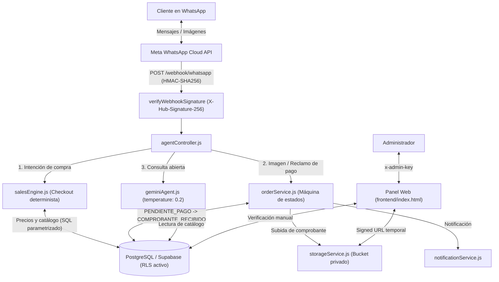

# WhatsApp Sales Agent & Order Management

Backend en **Node.js / Express** conectado a **Meta WhatsApp Cloud API**, **Google Gemini (`gemini-2.5-flash`)** y **PostgreSQL (Supabase)** para automatizar consultas de catálogo, creación de órdenes y recepción de comprobantes de pago.

Los precios, la disponibilidad y los estados de las órdenes se leen y actualizan directamente desde PostgreSQL. El modelo de lenguaje solo interviene en respuestas conversacionales abiertas y no tiene permisos para modificar ni aprobar pagos.

---

## Arquitectura



---

## Controles de Seguridad

Verificables con `npm run test:security`:

1. **Precios desde Base de Datos y Validación Manual de Pagos (`agentController.js`, `salesEngine.js`):**
   - `createCheckout` obtiene el precio directamente de las tablas `products` y `combos` en PostgreSQL.
   - Cuando el usuario envía una imagen o afirma haber pagado (`isClaimingPayment`), el controlador intercepta el mensaje antes de llamar a Gemini y cambia la orden únicamente a `COMPROBANTE_RECIBIDO`. El paso a `ENTREGADO` requiere acción manual desde el panel administrativo.
2. **Verificación de Firma en el Webhook (`authMiddleware.js`):**
   - `verifyWebhookSignature` conserva el buffer crudo (`req.rawBody`), calcula el `HMAC-SHA256` con `WHATSAPP_APP_SECRET` y compara la cabecera `X-Hub-Signature-256` mediante `crypto.timingSafeEqual`.
3. **Autenticación en Rutas Administrativas (`apiRoutes.js`):**
   - Todas las rutas bajo `/api/*` requieren la cabecera `x-admin-key` comparada con `crypto.timingSafeEqual`. Si `ADMIN_KEY` no está definida o tiene menos de 8 caracteres, el middleware responde `HTTP 503` (*fail-closed*).
4. **Row Level Security (RLS) en PostgreSQL (`database/schema.sql`):**
   - Las 7 tablas del esquema habilitan `ROW LEVEL SECURITY` para bloquear accesos directos con la llave pública `anon` de Supabase.
5. **Almacenamiento Privado de Comprobantes (`storageService.js`):**
   - El servidor no expone `/uploads` de forma estática. Los comprobantes se almacenan en un bucket privado de Supabase (o carpeta local privada) y solo se consultan mediante `GET /api/orders/:id/receipt-image` o *Signed URLs* temporales.
6. **Consultas Parametrizadas y Sanitización:**
   - Todas las consultas SQL utilizan parámetros posicionales (`$1, $2`) con `pg`.

---

## Instalación y Uso Local

### 1. Instalar dependencias
```bash
git clone https://github.com/martincito306/whatsapp-sales-agent.git
cd whatsapp-sales-agent
npm install
```

### 2. Variables de entorno
```bash
cp .env.example .env
```
Configura en `.env`:
- `DATABASE_URL`: Cadena de conexión PostgreSQL (Session Pooler IPv4 de Supabase).
- `ADMIN_KEY`: Clave de acceso para el panel administrativo (mínimo 8 caracteres).
- `GEMINI_API_KEY`: Clave de API de Google AI Studio.
- `WHATSAPP_TOKEN`, `WHATSAPP_PHONE_NUMBER_ID`, `WHATSAPP_VERIFY_TOKEN`, `WHATSAPP_APP_SECRET`: Credenciales de WhatsApp Cloud API.

### 3. Base de datos
Ejecuta [`database/schema.sql`](./database/schema.sql) en el editor SQL de Supabase para crear las tablas, activar RLS y cargar los datos de prueba.

### 4. Pruebas y ejecución
```bash
# Ejecutar pruebas de seguridad
npm run test:security

# Iniciar servidor en desarrollo
npm run dev
```

---

## Estructura del Proyecto

```text
whatsapp-sales-agent/
├── backend/
│   ├── ai/
│   │   ├── agentController.js      # Orquestador de mensajes, checkout y estados de pago
│   │   └── geminiAgent.js          # Cliente Gemini 2.5 Flash y motor de respaldo local
│   ├── config/
│   │   └── database.js             # Pool de conexiones PostgreSQL
│   ├── middlewares/
│   │   ├── authMiddleware.js       # adminAuth (timingSafeEqual) y verifyWebhookSignature (HMAC)
│   │   └── rateLimiter.js          # Límite de peticiones en memoria
│   ├── notifications/
│   │   └── notificationService.js  # Alertas por consola, Telegram y WhatsApp
│   ├── routes/
│   │   └── apiRoutes.js            # Endpoints REST del panel administrativo
│   ├── sales/
│   │   └── salesEngine.js          # Lógica de catálogo, presupuesto y creación de órdenes
│   ├── scripts/
│   │   └── test-security.js        # Pruebas automatizadas de autenticación, HMAC y sanitización
│   ├── services/
│   │   ├── catalogService.js       # Consultas a products, combos y system_settings
│   │   ├── customerService.js      # Estado del cliente y pausa de bot (hand-off)
│   │   ├── orderService.js         # Transiciones de estado de pedidos
│   │   ├── storageService.js       # Subida privada de comprobantes y Signed URLs
│   │   └── whatsappService.js      # Envío de mensajes y descarga de media en Graph API
│   ├── webhooks/
│   │   └── whatsappWebhook.js      # Endpoints GET/POST para el webhook de Meta
│   └── server.js                   # Configuración Express y captura de rawBody
├── database/
│   └── schema.sql                  # Tablas PostgreSQL, políticas RLS y catálogo inicial
├── frontend/
│   └── index.html                  # Panel administrativo SPA
├── .env.example
└── package.json
```

---

## Licencia
MIT
